# Hybrid tenant isolation: shared tables, row-level security, one heavy tenant on its own database

<picture>
  <source media="(prefers-color-scheme: dark)" srcset="demo/diagrams/container-dark.svg">
  
</picture>

One large customer slows every other customer down. Here, while one tenant's heavy job ran on the shared database, the other
tenants' p95 went from **5.1 ms to 39.6 ms**; with that tenant's ledger lines moved to a database of their own, it was **4.5 ms**,
and the move is rehearsed, verified and reversible. Everything else stays shared and isolated *below* the queries with PostgreSQL
row-level security, so a query that forgets its tenant filter still returns nothing foreign. The setting is the back office of an
accounting firm, on invented companies; every figure comes with the command that produced it.

| Where | What |
|---|---|
| [docs/current/features.md](docs/current/features.md) | What is built and how each rule is enforced |
| [docs/current/findings.md](docs/current/findings.md) | What building it showed: the surprises and the limits |
| [docs/current/verification.md](docs/current/verification.md) | How to run the suite and what the last runs measured |
| [demo/](demo/README.md) | Diagrams, evidence frames and the figures |
| [docs/current/architecture.md](docs/current/architecture.md) | The pieces, the decisions and their reasons |

What it covers:

- **Isolation that can be shown to fail.** A two-tenant test walks every registered query as two tenants and fails on any foreign
  row; with the policy switched off on one table, the same walk finds 100 foreign rows. A second test shows that the tenant setting
  does not survive a pooled connection, with its own negative control.
- **The reviewed cross-tenant exception.** An accountant who works for many clients reads across them only through a statement
  listed in `exceptions.yaml` with its hash, reviewer and date; the database refuses anything not listed or changed since review,
  and records each use.
- **Moving a tenant.** Copy, verify by fingerprint, switch the routing, then delete; rolling back is one routing change until the
  old rows are gone. 3,000,000 ledger lines copied and verified in 94 s.
- **SAF-T import.** Files are parsed as untrusted XML and validated; eight kinds of bad file are quarantined with their reasons, an
  identical file changes nothing and a corrected one replaces the period.
- **Offboarding.** A verified export first, personal data erased, accounting records kept, and a purge refused until a retention
  date is set and has passed.

You need Docker with Compose and Python 3.11 or later.

```bash
make install && make up && make sync-exceptions && make test   # 46 tests; needs Docker
make bench                                                     # the noisy-neighbour measurement
```

Measured on one laptop with this data and this query. The SAF-T files are a subset of the Portuguese structure, not validated
against the official XSD, and the retention date in the tests is made up: the legal period is for the accountant to confirm.

Every company, tax number and address is invented (companies named "Exemplo", valid-checksum tax numbers, `example.test`
addresses). The code is MIT-licensed ([LICENSE](LICENSE)).

---

**Daniel Colaço**, Software Architect: diagnosis, modernization and performance · [danielcolaco.pt](https://danielcolaco.pt/en/)

Written up in [One customer slows everyone down: shared database, or one per customer?](https://danielcolaco.pt/en/articles/tenants-of-very-different-sizes/)
